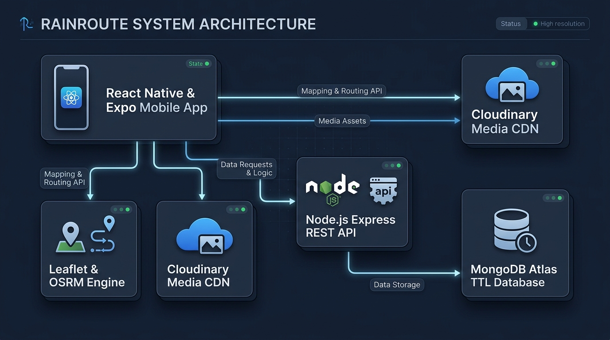
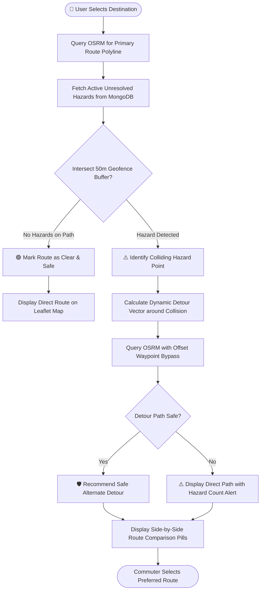
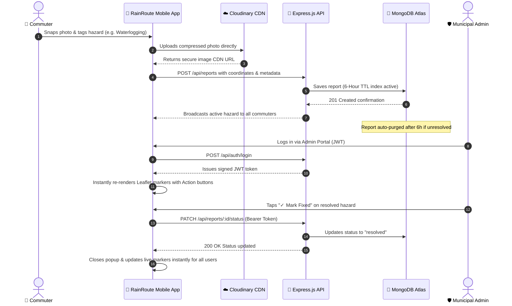
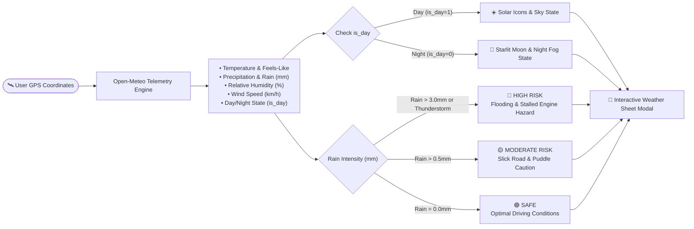

# 🌧️ RainRoute — Smart Monsoon Navigation & Hazard Telemetry

<div align="center">

[](https://reactnative.dev/)
[](https://expo.dev/)
[](https://nodejs.org/)
[](https://www.mongodb.com/atlas)
[](https://leafletjs.com/)
[](https://open-meteo.com/)
[](https://cloudinary.com/)
[](https://opensource.org/licenses/MIT)

**A full-stack, crowd-powered mobile navigation engine designed to combat urban waterlogging, unmapped potholes, and monsoon commuting hazards in real-time.**

[Explore Features](#-key-features) • [System Architecture](#-system-architecture) • [Interactive Workflows](#-interactive-system-workflows) • [Tech Stack](#-technical-stack) • [REST API](#-rest-api-reference) • [Quick Start](#-quick-start--installation) • [Free Deployment](#-production-deployment-guide-100-free)

</div>

---

### ⚡ Executive Summary / Quick Glance

| Pillar | Engineering Specification & Impact |
| :--- | :--- |
| **The Core Problem** | Monsoon downpours create **unmapped flash floods, submerged underpasses, open manholes, and street blockages** that standard GPS routing engines (Google Maps, Apple Maps) fail to detect in time, leading to stranded vehicles and compromised commuter safety. |
| **The Solution** | **RainRoute** delivers a unified, crowdsourced monsoon navigation platform featuring **real-time photo-verified hazard reporting**, **proactive path collision detection**, **automated flood-bypass detours**, **live hardware GPS tracking**, and **day/night meteorological weather telemetry**. |
| **Architectural Highlights** | **Role-Based Access Control (RBAC)** via JWT tokens, **50m spatial hazard geofencing**, **self-purging 6-hour TTL database indexes**, **zero-cost Leaflet vector mapping inside native WebView**, and **instant reactive DOM re-rendering** for administrative moderation without app restarts. |
| **Zero-Cost Production Stack** | **Frontend:** React Native (Expo SDK 52) • **Backend:** Node.js (Express v5) • **Database:** MongoDB Atlas • **Telemetry:** Open-Meteo API • **Media CDN:** Cloudinary |

---

## 🏗️ System Architecture

<p align="center">
  
</p>

### 🔄 End-to-End Data Pipeline

1. **Capture & Pre-Processing**: A commuter captures a road hazard using the native camera. On-device compression via `expo-image-manipulator` optimizes image dimensions to reduce mobile bandwidth consumption.
2. **Direct CDN Distribution**: The compressed asset is uploaded directly to **Cloudinary CDN** using an unsigned preset, returning an immutable secure HTTPS asset URL.
3. **Geo-Tagged Persistence**: The client dispatches a validated payload (`latitude`, `longitude`, `hazardType`, `severity`, `description`, `imageUrl`) to the **Node.js/Express REST API**.
4. **Automated Lifecycle Purging (TTL)**: MongoDB Atlas writes the document with an indexed `createdAt` timestamp. A native **MongoDB TTL index automatically purges the report after 6 hours**, ensuring outdated monsoon hazards never pollute subsequent route calculations.
5. **Spatial Hazard Analysis & Detour Rerouting**: The backend and client evaluate route polylines from the **OSRM routing engine** against a **50m proximity geofence**. When active hazards intersect the direct path, an automated waypoint-bypass detour is computed dynamically.
6. **Live Telemetry & Administrative Moderation**: Commuters receive real-time weather telemetry from **Open-Meteo**, while municipal administrators authenticate via **JWT credentials** to resolve or delete hazards and review community feedback.

---

## 🔁 Interactive System Workflows

### 1. Dynamic Hazard Detection & Flood-Bypass Detour Calculation



---

### 2. Live Incident Lifecycle & Instant Administrative Moderation



---

### 3. Real-Time Meteorological Telemetry & Flood Safety Engine



---

## ✨ Key Features

### 🗺️ Production Google Maps-Grade Navigation Interface
* **Floating Material Search Card**: Streamlined search header with real-time address suggestions (debounced via OpenStreetMap Nominatim), live report pulse indicator, and hamburger navigation drawer.
* **Turn-by-Turn Navigation Card**: Displays clear **ETA in minutes**, arrival distances, safety alerts, and single-tap alternative detour switcher pills.
* **Hardware-Driven Live GPS Tracking**: Tapping **"Start Navigation"** activates continuous hardware positioning via `Location.watchPositionAsync` (`timeInterval: 2000`, `distanceInterval: 2`), keeping the camera and pulsing user location dot locked to your real-time vehicle movement.
* **Custom Slender Needle-Point Pins**: Vector SVGs for **Destination (Red `#EA4335`)** and **Start (Green `#10B981`)** with tapered needle tips and solid dark cores, built with **50m touch proximity protection** to eliminate accidental pin drops when tapping near hazard markers.
* **Elevated Ambient Action Controls**: The floating **"Report Hazard"** button and quick utility dock (GPS Locate, SOS, Refresh) remain fully accessible and smoothly elevate above the direction card when active navigation begins.

---

### 🌤️ Day/Night Live Meteorological Weather & Flood Safety Telemetry
* **100% Free Open-Source Meteorological Telemetry**: Integrates with the **Open-Meteo API** (zero API keys, unlimited requests) paired with reverse geocoding to display real-time weather for your exact GPS locality.
* **Day vs. Night Intelligence**: Leverages meteorological `is_day` telemetry with automatic local-time fallbacks. Displays **moonlight starlit icons (`🌙 Clear Night`, `☁️🌙 Partly Cloudy Night`)** after dusk and **solar indicators (`☀️ Clear Sky`)** during daytime.
* **RainRoute Road Flooding Safety Meter**:
  * 🟢 **SAFE**: Optimal driving conditions and dry corridors.
  * 🟡 **MODERATE**: Wet asphalt alert, reduced friction, and hydroplaning warning.
  * 🔴 **HIGH**: Torrential downpour / thunderstorm alert warning of submerged underpasses and waterlogging.
* **Interactive Weather Details Sheet**: 4-card metric grid tracking **Rain Intensity (`mm`)**, **Relative Humidity (`%`)**, **Wind Speed (`km/h`)**, and **Apparent Feels-Like Temperature (`°C`)**.

---

### ⚠️ Multi-Category Crowdsourced Hazard Detection
* Supports distinct incident categories tailored for monsoon emergencies:
  * 🌊 **Waterlogging / Flood**: Deep puddles, flooded streets, impassable underpasses.
  * 🕳️ **Pothole / Open Manhole**: Hidden road cavities disguised by standing rainwater.
  * 🚧 **Road Construction**: Unmarked excavation zones and utility works.
  * ⛔ **Road Obstacle**: Fallen tree branches, stalled vehicles, road debris.
  * 💥 **Accident**: Collision zones causing corridor bottlenecks.
  * ⚠️ **General Hazard**: Low-hanging electric wires and hazardous conditions.
* Interactive Leaflet vector popups show **category badges**, **severity levels**, **photo evidence**, and **one-tap admin actions**.

---

### 🛡️ Role-Based Access Control (RBAC) & Municipal Moderation
* **Frictionless Public Experience**: Commuters can search destinations, compute safe detours, report hazards, and submit feedback without account registration.
* **Municipal Admin Control Center**: Municipal staff sign in using **bcrypt-hashed credentials and signed JWT tokens**.
* **Instant Reactive Re-rendering**: Toggling a report's status to **"Fixed"** or **"Deleted"** updates the live Leaflet map **immediately** for all connected devices without latency.
* **Community Feedback Dashboard**: Administrators can switch to the **Feedback Tab** to review commuter star ratings (1-5 stars), categories (`Bug`, `Feature`, `Routing`, `UI/UX`), feedback messages, and contact emails.

---

### 🚨 Emergency SOS & Monsoon Safety Protocols
* **1-Tap Emergency Hotlines**: Native phone dialer triggers for:
  * 🚓 **Police Dispatch**: `112`
  * 🌊 **Disaster Management / Flood Control**: `1077`
  * 🚑 **Emergency Medical Ambulance**: `108`
  * 🚒 **Fire & Rescue**: `101`
* **Instant GPS Distress Broadcast**: Packages the user's real-time latitude and longitude into a clickable Google Maps link ready for 1-tap dispatch via WhatsApp or SMS.
* **Critical Monsoon Commuter Protocols**: Advisories on vehicle water clearance limits (6 inches can stall engines; 12 inches can float vehicles) and electrical hazards.

---

## 🛠️ Technical Stack

### **Frontend Architecture (Mobile Application)**

| Technology / Library | Version | Technical Role & Implementation Rationale |
| :--- | :--- | :--- |
| **React Native** | `v0.76` | Cross-platform native mobile foundation with high-performance UI thread execution. |
| **Expo** | `SDK 52` | Unified mobile runtime providing managed access to native hardware APIs. |
| **React Native WebView** | `v13.16` | Sandboxed, high-performance web container for rendering zero-cost vector map tiles. |
| **Leaflet.js** | `v1.9.4` | Lightweight open-source vector mapping engine rendering OpenStreetMap tiles without API keys. |
| **Expo Location** | `~57.0` | High-accuracy hardware GPS tracking via `Location.watchPositionAsync`. |
| **Expo Image Manipulator** | `~57.0` | Client-side image resizing and JPEG compression before CDN dispatch. |
| **Expo Image Picker** | `~57.0` | Native camera capture and gallery photo selection. |
| **OSRM Engine** | *REST API* | Open Source Routing Machine for polyline calculation and detour waypoints. |
| **Open-Meteo API** | *REST API* | Open-source, keyless meteorological feed for real-time rain, temperature, and day/night telemetry. |
| **React Native Toast Message** | `^2.4.0` | High-visibility notifications positioned below the floating search bar. |

---

### **Backend Architecture (REST API Service)**

| Technology / Library | Version | Technical Role & Implementation Rationale |
| :--- | :--- | :--- |
| **Node.js** | `v20.x` | Asynchronous event-driven JavaScript runtime engine. |
| **Express.js** | `v5.x` | Minimalist HTTP web framework for REST API routing and middleware pipelines. |
| **MongoDB Atlas** | `Cloud M0` | Globally distributed cloud NoSQL database with automated clustering. |
| **Mongoose** | `v9.x` | Object Data Modeling (ODM) library managing schemas and validation. |
| **MongoDB Native TTL** | *Native Engine* | Automated 6-hour index expiry (`expireAfterSeconds: 21600`) for self-purging hazard records. |
| **JSON Web Tokens (JWT)** | `v9.x` | Cryptographically signed bearer tokens for municipal admin role authorization. |
| **bcryptjs** | `v3.x` | Salted password hashing for administrative credential verification. |
| **Cloudinary SDK** | *Cloud API* | Scalable cloud media pipeline for hosting and optimizing hazard photo assets. |
| **CORS & Dotenv** | `v2.8 / v16.4` | Cross-origin resource sharing enablement and environment variable management. |

---

## 📡 REST API Reference

Base Endpoint: `http://<SERVER_HOST>:3000/api`

### 1. Public Commuter Endpoints (No Authentication Required)

| Method | Endpoint | Description | Request Body Payload | Status Code |
| :--- | :--- | :--- | :--- | :--- |
| `POST` | `/api/reports` | Submit a new crowdsourced hazard report | `{ latitude, longitude, imageUrl, hazardType, severity, description }` | `201 Created` |
| `GET` | `/api/reports` | Retrieve all active, non-expired hazards | *None* | `200 OK` |
| `GET` | `/api/reports/stats` | System health check and active hazard tally | *None* | `200 OK` |
| `POST` | `/api/feedback` | Submit commuter star rating and suggestions | `{ rating, category, message, contactEmail }` | `201 Created` |

### 2. Administrative Moderation Endpoints (Requires `Authorization: Bearer <TOKEN>`)

| Method | Endpoint | Description | Request Body Payload | Status Code |
| :--- | :--- | :--- | :--- | :--- |
| `POST` | `/api/auth/login` | Authenticate admin credentials and generate JWT | `{ username, password }` | `200 OK` |
| `GET` | `/api/auth/verify` | Verify active JWT session token validity | *None* | `200 OK` |
| `GET` | `/api/reports/all` | Fetch all historical reports (active + resolved) | *None* | `200 OK` |
| `PATCH` | `/api/reports/:id/status` | Toggle hazard status between "resolved" & "active" | `{ status: "resolved" \| "active" }` | `200 OK` |
| `DELETE` | `/api/reports/:id` | Permanently remove hazard record from database | *None* | `200 OK` |
| `GET` | `/api/feedback` | Retrieve all commuter feedback entries | *None* | `200 OK` |

---

## 📂 Project Structure

```text
RainRoute/
├── docs/
│   └── architecture.png           # System architecture infographic
├── README.md                      # Primary project portfolio documentation
├── .gitignore                     # Repository-wide ignore definitions
│
├── rainroute-backend/             # Node.js / Express.js REST API
│   ├── .env.example               # Environment variables template
│   ├── server.js                  # Application entry point & route registration
│   ├── package.json               # Backend dependencies & scripts
│   └── src/
│       ├── config/
│       │   └── db.js              # Mongoose MongoDB Atlas connection manager
│       ├── controllers/
│       │   ├── authController.js     # Admin login & JWT verification
│       │   ├── reportController.js   # Hazard submission, status toggle & deletion
│       │   └── feedbackController.js # Feedback submission & retrieval
│       ├── middleware/
│       │   ├── authAdmin.js          # JWT Bearer token authentication guard
│       │   ├── errorHandler.js       # Global JSON error handling middleware
│       │   └── logger.js             # HTTP request audit logging
│       ├── models/
│       │   ├── Report.js             # Hazard schema with 6-Hour TTL index
│       │   └── Feedback.js           # Community feedback schema
│       ├── routes/
│       │   ├── authRoutes.js         # /api/auth endpoints
│       │   ├── reportRoutes.js       # /api/reports endpoints
│       │   └── feedbackRoutes.js     # /api/feedback endpoints
│       └── services/
│           └── reportService.js      # Database query abstractions
│
└── rainroute/                     # React Native / Expo Mobile Application
    ├── app.json                   # Expo application manifest, icons & permissions
    ├── App.js                     # Root state orchestrator, GPS routing & map bridge
    ├── package.json               # Mobile frontend dependencies
    ├── assets/                    # App branding, splash screens & custom icons
    └── src/
        ├── components/
        │   ├── MapScreen.js          # Leaflet vector map inside React Native WebView
        │   ├── ActionButtons.js      # Floating elevated action controls (Report, SOS, GPS)
        │   ├── WeatherWidget.js      # Open-Meteo live weather & flood safety modal
        │   ├── ReportHazardModal.js  # Multi-category incident reporting dialog
        │   ├── SosModal.js           # Emergency helplines & location broadcast
        │   ├── FaqModal.js           # Interactive commuter guidance accordion
        │   ├── FeedbackModal.js      # Commuter star ratings & suggestion form
        │   ├── AdminModal.js         # Admin authentication, hazards & feedback dashboard
        │   └── MenuDrawer.js         # Slide-over production navigation drawer
        ├── config/
        │   └── cloudinary.js         # Cloudinary cloud configuration
        └── services/
            ├── apiService.js         # Dynamic host resolver, OSRM client & REST API calls
            ├── locationService.js    # High-precision hardware GPS positioning
            └── uploadService.js      # Media capture, compression & Cloudinary pipeline
```

---

## 🚀 Quick Start & Installation

### Prerequisites
* **Node.js** (`v18.x` or `v20.x`)
* **Git** installed on your system
* **Expo Go App** installed on your Android or iOS device ([Android Play Store](https://play.google.com/store/apps/details?id=host.exp.exponent) / [iOS App Store](https://apps.apple.com/app/expo-go/id982107779))

---

### 1. Backend Service Setup (`rainroute-backend`)

```bash
# 1. Navigate to backend directory
cd rainroute-backend

# 2. Install dependencies
npm install

# 3. Create environment file from template
cp .env.example .env

# 4. Start backend server
npm start
```
* The server will initialize on port `3000` and confirm connection to MongoDB Atlas.

---

### 2. Mobile Frontend Setup (`rainroute`)

```bash
# 1. Navigate to mobile frontend directory
cd rainroute

# 2. Install dependencies
npm install

# 3. Start Expo development server with cache clear
npx expo start -c
```
* Scan the generated QR code using the **Expo Go app** on your physical mobile device to test live navigation, weather telemetry, and hazard reporting.

---

## 🌐 Production Deployment Guide (100% Free)

RainRoute is engineered to be deployed as a public production application completely free of charge:

### 1. Free Backend API Hosting (Render)
1. Create a free account at **[render.com](https://render.com)**.
2. Select **New Web Service** and link your GitHub repository: `https://github.com/rishipatel83/RainRoute`.
3. Configure the service:
   * **Root Directory:** `rainroute-backend`
   * **Build Command:** `npm install`
   * **Start Command:** `npm start`
4. In the **Environment Variables** tab, add:
   * `MONGO_URI`: Your MongoDB Atlas connection string.
   * `JWT_SECRET`: A secure cryptographically random string.
   * `ADMIN_USER`: `admin`
   * `ADMIN_PASSWORD`: Your chosen admin password.
5. Click **Deploy Web Service**. Render provisions a secure production HTTPS endpoint: `https://rainroute-backend.onrender.com`.

---

### 2. Connect Mobile Frontend to Production Backend
1. Open [rainroute/src/services/apiService.js](file:///d:/CODES/RainRoute/rainroute/src/services/apiService.js).
2. Set your production Render URL as the default fallback:
   ```javascript
   export const DEFAULT_BASE_API_URL = 'https://rainroute-backend.onrender.com/api';
   ```

---

### 3. Generate Standalone Android APK for Free (EAS Build)
Using Expo Application Services (EAS Build), you can compile a standalone `.apk` binary installable on any Android phone:

```bash
# 1. Install EAS CLI globally
npm install -g eas-cli

# 2. Authenticate with your free Expo account
eas login

# 3. Initialize build configuration
eas build:configure

# 4. Trigger cloud compilation for Android preview APK
eas build -p android --profile preview
```
* Once compilation finishes, Expo provides a direct download link for your standalone installable `.apk` file.

---

### 4. Global Distribution via GitHub Releases
1. In your GitHub repository, navigate to **Releases** > **Draft a new release**.
2. Tag your release (e.g., `v1.0.0`).
3. Upload the compiled `RainRoute.apk` file as a binary asset.
4. Any commuter globally can download, install, and run the app directly on their mobile device.

---

## 👨‍💻 Author & Contributions

* **Author:** Rishi Patel ([@rishipatel83](https://github.com/rishipatel83))
* **Repository:** [https://github.com/rishipatel83/RainRoute](https://github.com/rishipatel83/RainRoute)
* **Contact:** [rishi.777.patel@gmail.com](mailto:rishi.777.patel@gmail.com)
* **License:** Licensed under the [MIT License](https://opensource.org/licenses/MIT). Open-source contributions and feature suggestions are welcome via Pull Requests.
